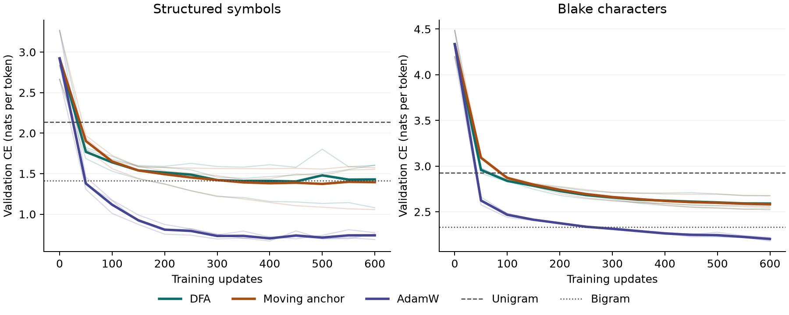

# C02-A decoder learning decision

**C02-B is justified as a bounded GPU benchmark of time to matched quality.** The local decoder learned next-token prediction from random initialization, used earlier context on both tasks and updated every trainable tensor. Its real-text quality remains the main blocker to a training-cost claim. All three local seeds finished behind a smoothed bigram on held-out poetry, and AdamW achieved substantially lower loss within the same number of updates.

## Learning results

Each run used 600 updates, 12 sequences per update and 16 prediction targets per sequence (115,200 training targets). Methods shared the forward architecture, initialization, minibatch stream and evaluation points within each task/seed pair. The real corpus contains 45 poems split 33/6/6 before vocabulary fitting. Validation scored 984 grammar symbols or 2,992 poem characters including document-end targets. Metrics below are arithmetic means over seeds 11, 29 and 47. Perplexity was computed separately for each run. [Fixed protocol](C02A_PROTOCOL.md) · [Corpus provenance](data/c02a/README.md)

| Task | Method | Initial val CE | Final val CE | Val PPL | Test CE | Test PPL |
| --- | --- | ---: | ---: | ---: | ---: | ---: |
| Structured symbols | DFA | 2.922 | 1.429 | 4.30 | 1.456 | 4.40 |
| Structured symbols | Moving anchor | 2.922 | 1.395 | 4.15 | 1.420 | 4.24 |
| Structured symbols | AdamW | 2.922 | 0.739 | 2.10 | 0.747 | 2.11 |
| Blake characters | DFA | 4.335 | 2.591 | 13.36 | 2.632 | 13.93 |
| Blake characters | Moving anchor | 4.335 | 2.582 | 13.26 | 2.627 | 13.86 |
| Blake characters | AdamW | 4.335 | 2.203 | 9.05 | 2.240 | 9.40 |

All 18 primary runs passed the prespecified learning check of beating initialization and the training unigram's validation CE. On structured sequences, unigram/bigram validation CE was 2.136/1.416. On poetry it was 2.929/2.332. Two of three DFA seeds missed the structured bigram and all three missed the poetry bigram. AdamW beat both bigrams on every seed. The moving anchor produced a small mean CE gain for additional state and update work.



Thin lines show individual seeds; thick lines show method means. [Per-seed CE, perplexity and accuracy at every evaluation](results/c02a/validation_curves.csv)

## What the local attention learned

At fixed trained DFA weights, allowing each position to attend only to itself raised validation CE on every seed. The increases were **0.103–0.501** nats per symbol on the grammar and **0.221–0.302** nats per character on poetry. Earlier tokens therefore contributed to held-out prediction. Structured first-move validation accuracy averaged **73.3% for DFA**, **71.7% for the anchor** and **93.4% for AdamW**.

All 11 groups changed on the first minibatch and in the final deployed weights for every method and seed. Counts in the coverage file distinguish individual elements from groups. Embedding rows receive updates only when observed as inputs. A separate, exploratory validation check reset one deployed group to its random initial value while leaving the others trained. For poetry DFA, resetting Q, K or V raised mean CE by **0.199, 0.133 and 0.577**, respectively, with deterioration on all three seeds for each projection. This tests reliance on each group's trained value in the fitted model.

**Weakest local path.** Resetting the FF normalization gain worsened CE on only one of three DFA seeds on each task. The two structured FF matrices also had mixed effects across seeds. These groups receive finite local updates, but their independent quality contribution is inconsistent in this smoke test. No group was frozen or handed to Autograd. [Explicit credit equations for every tensor](C02A_MODEL.md) · [Per-seed parameter changes and reset effects](results/c02a/parameter_coverage.csv)

## Engineering verification and cost

**Software PASS, 31/31.** The tests cover prefix invariance at every position, exactly zero future attention, shifted document-local targets, train-only vocabulary fitting, identical initial logits, and finite atomic local updates. Runtime guards reject gradient recording and differentiation calls in the local step. Finite differences check Q/K/V against the direct-feedback attention objective. The 23 historical tests remain part of the suite. [New tests](tests/test_decoder.py)

**Checkpoint replay PASS, 18/18.** Recreating the learner and sampler at update 300 reproduced all recorded validation points, test scores, context interventions, coverage metrics and batch fingerprints exactly. Timing was excluded from this comparison. Runs used CPU float32, one PyTorch thread, Python 3.14.4 and PyTorch 2.12.0+cpu. [Replay audit](results/c02a/audit.json)

| Poetry decoder | Deployed elements | Training-only elements | Training-only bytes | Mean CPU training seconds |
| --- | ---: | ---: | ---: | ---: |
| DFA | 10,912 | 11,808 | 47,232 | 3.66 |
| Moving anchor | 10,912 | 22,720 | 90,880 | 4.77 |
| AdamW | 10,912 | 21,835 | 87,340 | 5.66 |

The structured model deploys 8,992 elements. Both architectures also use 2,304 bytes for fixed positions and mask. State counts are resident tensors between updates and exclude temporary activations, gradients and allocator overhead. CPU training time includes sampling and updates and excludes evaluation and checkpoint I/O. These are equal-update timings at **different achieved losses**. Fixed feedback storage already exceeds the poetry decoder's deployed weight storage and grows with vocabulary size. [Structured telemetry](results/c02a/structured_primary.jsonl) · [Poetry telemetry](results/c02a/blake_primary.jsonl)

## Review recommendation

Use C02-B to test a specified cost question: at a validation CE reachable by both local DFA and AdamW, how much accelerator time and peak allocated memory does each require? Register a second, stronger quality target and retain misses. The short contexts, one block, character vocabulary and six held-out validation poems limit generalization. The AdamW and bigram gaps argue against using this smoke test to justify large-model training. C02-A used CPU resources only.

## Reproduction

Run from the checkout root. The corpus is bundled. The default command runs the structured task first, then the poetry task, with all three learners and both uninterrupted and checkpoint-resumed runs. The review command exports curves and group coverage. Add `--plot` to the review command when Matplotlib is installed to regenerate the figure.

```powershell
python -m unittest discover -s tests -v
python -m benchmarks.c02a --output c02a.local
python -m benchmarks.c02a_review c02a.local
```
